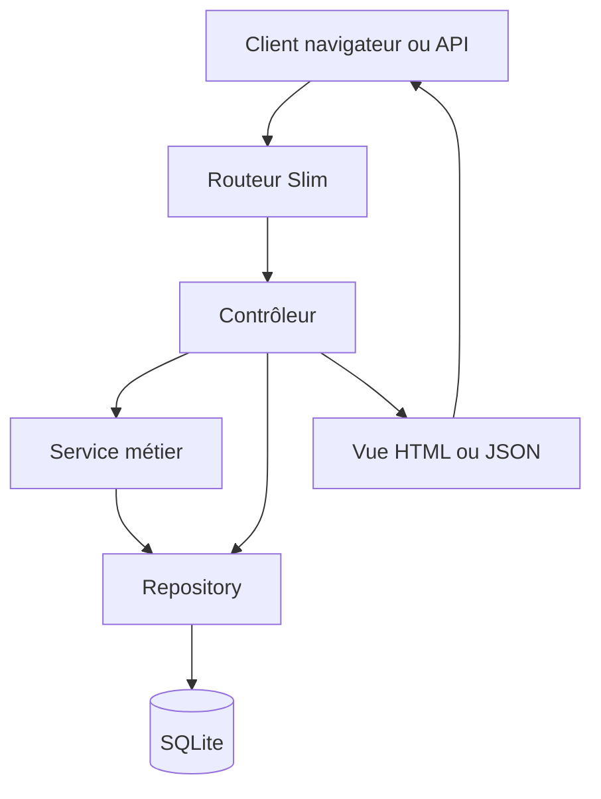
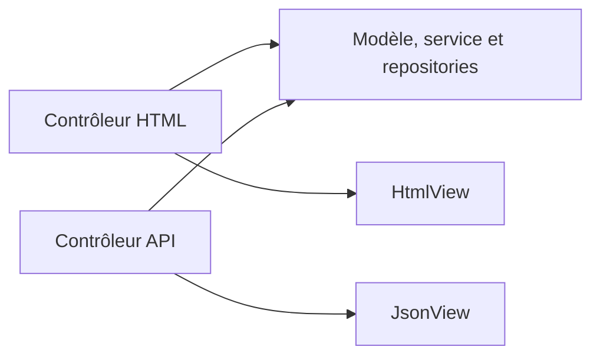
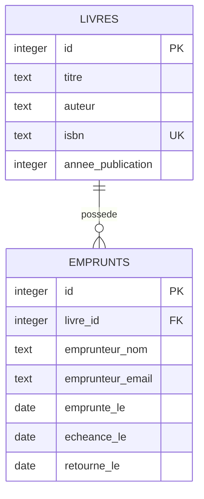

# Bibliothèque MVC — Slim 4

Une petite application métier volontairement lisible pour étudier **MVC avec Slim 4**, PDO et SQLite. Le même cœur applicatif alimente deux représentations :

- une interface HTML utilisable dans un navigateur ;
- une API JSON utilisable par une application mobile, un client JavaScript ou un outil comme Bruno/Postman.

Le projet gère un catalogue de livres, leur recherche, les emprunts et les retours. Il met surtout en évidence la séparation des responsabilités : le routeur choisit un contrôleur, le contrôleur orchestre, le modèle protège les règles métier, le repository dialogue avec SQLite et la vue fabrique la réponse.

## Démarrage rapide

Prérequis : PHP 8.2 ou supérieur, Composer, les extensions `pdo_sqlite` et `mbstring`.

```bash
composer install
composer db:init
composer serve
```

Ouvrez ensuite <http://localhost:8080>. La commande `db:init` conserve les données existantes ; `composer db:fresh` recrée entièrement la base et ses données de démonstration.

## Fonctionnalités

- lister et rechercher les livres par titre ou auteur ;
- afficher, créer, modifier et supprimer un livre ;
- enregistrer un emprunt pour 21 jours puis son retour ;
- empêcher deux emprunts simultanés du même exemplaire ;
- conserver l'historique et interdire la suppression d'un livre déjà emprunté ;
- exposer les mêmes cas d'utilisation en HTML et en JSON ;
- retourner des codes HTTP et des erreurs JSON cohérents ;
- protéger les formulaires HTML avec un jeton CSRF ;
- valider les données dans le modèle, indépendamment du canal d'entrée.

> Le format d'un ISBN est contrôlé (10 ou 13 caractères après normalisation), mais pas encore sa clé de contrôle. C'est une extension pédagogique possible.

## Architecture



Le fichier `public/index.php` est le **point de composition** : il crée les objets, injecte leurs dépendances, configure Slim puis charge les routes. Aucun conteneur magique n'est nécessaire pour comprendre ce qui se passe.

| Couche | Responsabilité | Elle ne doit pas… |
|---|---|---|
| Route | associer méthode + URL à une action | contenir une règle métier |
| Contrôleur | lire la requête, appeler le métier, choisir la réponse | écrire du SQL ou du HTML |
| Modèle | représenter les objets et protéger leurs invariants | connaître HTTP ou PDO |
| Service | orchestrer un cas métier impliquant plusieurs objets | produire une réponse HTTP |
| Repository | exécuter les requêtes et hydrater les modèles | décider de la présentation |
| Vue | produire du HTML ou du JSON | interroger la base de données |

Deux contrôleurs de présentation réutilisent donc les mêmes couches métier :



La documentation détaillée se trouve dans [docs/ARCHITECTURE.md](docs/ARCHITECTURE.md).

## Arborescence commentée

```text
public/index.php             Front controller et composition des dépendances
config/routes.php            Table des routes HTML et API
src/Controller/              Adaptateurs HTTP HTML et JSON
src/Model/                   Entités et exceptions métier
src/Service/                 Cas d'utilisation emprunter / retourner
src/Repository/              Accès PDO et hydratation
src/View/                    Rendu HTML et sérialisation JSON
views/                       Templates PHP sans accès aux données
database/schema.sql          Structure et contraintes SQLite
database/fixtures.sql        Jeu de démonstration
tests/                       Tests unitaires et d'intégration légère
docs/                        Architecture, API et requêtes d'exemple
```

## Routes HTML

| Méthode | URL | Action |
|---|---|---|
| GET | `/livres` | catalogue et recherche avec `?q=...` |
| GET | `/livres/nouveau` | formulaire de création |
| POST | `/livres` | création puis redirection `303` |
| GET | `/livres/{id}` | détail et historique |
| GET | `/livres/{id}/modifier` | formulaire de modification |
| POST | `/livres/{id}/modifier` | modification puis redirection |
| POST | `/livres/{id}/supprimer` | suppression si aucun historique |
| POST | `/livres/{id}/emprunter` | nouvel emprunt |
| POST | `/emprunts/{id}/retour` | retour d'un livre |

Les mutations HTML suivent le motif **POST/Redirect/GET** : après réussite, le contrôleur répond `303 See Other`. Actualiser la page ne rejoue donc pas le formulaire.

## API JSON

| Méthode | URL | Résultat attendu |
|---|---|---|
| GET | `/api/livres?q=asimov` | `200` et une collection |
| POST | `/api/livres` | `201`, la ressource et `Location` |
| GET | `/api/livres/{id}` | `200` ou `404` |
| PATCH | `/api/livres/{id}` | `200`, modification partielle |
| DELETE | `/api/livres/{id}` | `204`, `404` ou `409` |
| POST | `/api/livres/{id}/emprunts` | `201`, `404`, `409` ou `422` |
| PATCH | `/api/emprunts/{id}/retour` | `200`, `404` ou `409` |

Exemple :

```bash
curl -i -X POST http://localhost:8080/api/livres \
  -H 'Content-Type: application/json' \
  -d '{"titre":"La Horde du Contrevent","auteur":"Alain Damasio","isbn":"9782070464230","annee_publication":2004}'
```

Les erreurs ont une forme stable :

```json
{
  "erreur": {
    "code": "DONNEES_INVALIDES",
    "message": "Le titre est obligatoire et limité à 120 caractères."
  }
}
```

Consultez [docs/API.md](docs/API.md), [docs/openapi.yaml](docs/openapi.yaml) et [docs/requests.http](docs/requests.http) pour expérimenter.

## Base de données



L'index SQLite partiel `un_emprunt_actif_par_livre` garantit qu'un livre n'a jamais deux emprunts ouverts, même si deux requêtes arrivent presque au même moment. Une règle importante est ainsi protégée à la fois par le service métier et par la base.

## Vérification

```bash
composer lint
composer test
composer check
```

Les tests portent sur les invariants du modèle, l'accès aux données, les règles d'emprunt et l'échappement HTML. La CI GitHub exécute les mêmes contrôles à chaque push et pull request.

## Pistes de travaux pratiques

1. Contrôler réellement la clé des ISBN-10 et ISBN-13 dans `Livre`.
2. Ajouter la pagination à la liste HTML et à l'API.
3. Créer une table `adherents` et remplacer les coordonnées copiées dans `emprunts` par une relation.
4. Ajouter une règle de retard et calculer le nombre de jours dépassés.
5. Écrire une route `GET /api/emprunts` avec filtres actif/en retard.
6. Ajouter une authentification bibliothécaire et distinguer lecture publique et administration.
7. Remplacer SQLite par MariaDB sans modifier les contrôleurs.

Chaque évolution doit conserver le principe directeur : **une règle métier n'est écrite qu'une fois et reste utilisable depuis HTML comme depuis JSON**.

## Licence

Projet pédagogique distribué sous licence MIT.
