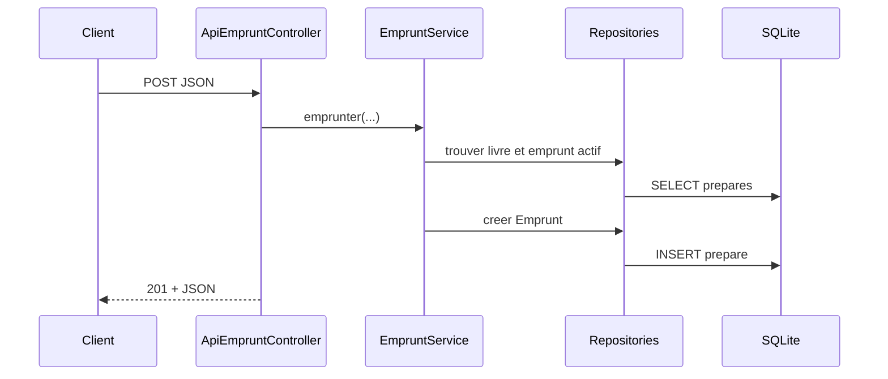

# Comprendre l'architecture

## Une requête, étape par étape

Pour `POST /api/livres/2/emprunts` :

1. Slim reconnaît la route dans `config/routes.php`.
2. `ApiEmpruntController` extrait l'identifiant et le corps JSON.
3. `EmpruntService` vérifie l'existence et la disponibilité du livre.
4. `LivreRepository` et `EmpruntRepository` exécutent les requêtes préparées.
5. `Emprunt` valide le nom, l'adresse électronique et les dates.
6. `JsonView` sérialise le résultat et renvoie `201 Created`.



## Les dépendances vont vers le métier

Le modèle `Livre` ne dépend ni de Slim, ni de PDO, ni d'un template. On peut donc le tester avec un simple `new Livre(...)`. Le framework reste à la périphérie de l'application.

Les contrôleurs dépendent explicitement de leurs collaborateurs par le constructeur. `public/index.php` les assemble :

```php
$livres = new LivreRepository($pdo);
$emprunts = new EmpruntRepository($pdo);
$service = new EmpruntService($livres, $emprunts);
$controller = new ApiEmpruntController($service, $jsonView);
```

Cette injection rend les besoins visibles et évite les variables globales ou les créations de connexion dispersées.

## Modèle et invariants

Un invariant est une règle qui doit toujours être vraie. `Livre` refuse par exemple un titre vide, quelle que soit l'origine des données. Une validation placée uniquement dans le formulaire HTML serait contournée par l'API JSON.

`Emprunt` garantit notamment :

- un identifiant de livre positif ;
- un nom de 2 à 120 caractères ;
- une adresse électronique valide ;
- une échéance postérieure à l'emprunt.

Le service ajoute les règles nécessitant plusieurs objets : existence du livre, disponibilité, durée de 21 jours et impossibilité de rendre deux fois.

## Repositories

Les repositories constituent la frontière avec la persistance. Ils reçoivent un `PDO`, utilisent exclusivement des requêtes préparées et transforment les lignes SQL en objets métier.

Le reste du code ignore ainsi que les colonnes sont nommées `annee_publication` et `retourne_le`. Changer de schéma ou de moteur affecterait principalement cette couche.

## Deux représentations, un seul métier

L'interface HTML et l'API possèdent des contrôleurs distincts car elles n'ont pas le même protocole de dialogue :

| HTML | JSON |
|---|---|
| formulaire encodé | objet JSON |
| message flash en session | corps d'erreur structuré |
| redirection après POST | ressource et statut HTTP |
| template dans un layout | sérialisation JSON |

En revanche, elles utilisent les mêmes objets `Livre`, `Emprunt`, repositories et service. Aucun calcul métier ne doit être recopié dans un contrôleur API.

## Gestion des erreurs

Les erreurs prévisibles sont traduites près du cas d'utilisation :

- données invalides → `422 Unprocessable Entity` ;
- ressource absente → `404 Not Found` ;
- conflit d'état, comme un livre déjà emprunté → `409 Conflict` ;
- création réussie → `201 Created` avec un en-tête `Location` ;
- suppression réussie sans corps → `204 No Content`.

Le gestionnaire global s'occupe des erreurs non prévues. Il choisit HTML ou JSON en fonction du préfixe `/api/` et masque les détails en production (`APP_ENV=production`).

## Sécurité déjà illustrée

- paramètres SQL liés, jamais concaténés ;
- échappement HTML au dernier moment avec `htmlspecialchars` ;
- jeton CSRF sur toutes les mutations HTML ;
- cookies de session `HttpOnly` et `SameSite=Lax` ;
- contraintes SQLite en deuxième ligne de défense ;
- détails des exceptions désactivés en production.

Ce projet reste pédagogique : une mise en production demanderait notamment HTTPS, authentification, autorisations, journalisation structurée, secrets hors dépôt et stratégie de sauvegarde.
